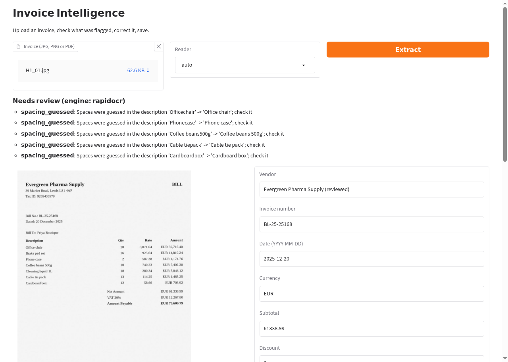

# Invoice Intelligence

Reads an invoice (scanned image or PDF) and returns structured data: vendor, invoice number, date,
currency, line items, subtotal, discount, tax lines, rounding and total. It checks the arithmetic,
sends anything doubtful to a human review queue, and keeps a history of what was corrected.
It also contains its own labelled dataset generator and an evaluation harness, so every accuracy
number below can be reproduced.

**Status: portfolio project, tested on synthetic invoices only. It is not production software, not job-ready proof, and
has not been tried on real invoices. The rule-based extractor failed on unseen label wording in the fresh stress set (see Results), and OCR
drops spaces in item descriptions, so a reviewer must check every extraction.**

## How it works

```
image / PDF -> text boxes -> lines -> item table + totals block -> arithmetic checks -> review queue -> CSV
              (OCR boxes with     (by position)   (columns by quantity x rate    (never rejects,
               position and                        = amount; totals roles          flags for review)
               confidence)                         solved by arithmetic)
```

- `invoice_ai/ocr.py`: RapidOCR, Tesseract, or the text layer of a digital PDF (pdfplumber). All three return text boxes with positions and confidence.
- `invoice_ai/extract.py`: geometry-based extractor. The item table is the longest run of lines ending in a right-aligned money amount;
  the quantity and rate columns are found because quantity x rate = amount; the totals block is the amounts under the table and its roles
  (subtotal, discount, tax, rounding, total) are chosen by solving `total = subtotal - discount + tax + rounding`. Label words are hints and tie-breakers.
  If more than one reading fits, the invoice goes to review (`ambiguous_*` issues). Invoice number and date come from `label: value` pairs above the table,
  the vendor from the first text on the page. It is heuristic code, not a trained model.
- `invoice_ai/rules.py`: the earlier label-based extractor, kept as a baseline for comparison and for helper functions.
- `invoice_ai/validate.py`: line total, subtotal, grand total, tax-rate checks. Tax lines are generic (CGST, SGST, IGST, VAT, ...). Tax-inclusive invoices do not fit this model and are flagged, not accepted silently.
- `invoice_ai/store.py`: SQLite review history (original extraction, final values, which fields the reviewer changed) and CSV export.
- `invoice_ai/api.py`: FastAPI service. `invoice_ai/ui.py`: Gradio review screen at `/ui`.
- `invoice_ai/generate.py`: synthetic invoice generator (the original dataset). `invoice_ai/evaluate.py`: evaluation.

### Supported scope (anything else should end up in review)

One page, English, printed text, one item table with right-aligned number columns, money amounts written with two decimals, a totals block under the table,
day-first, year-first (`2025/08/23`) or written-month dates, `.` as decimal separator. Not supported, with examples seen in testing: a table whose numbers are not right-aligned, amounts without decimals, several pages or several tables, handwriting, stamps, scanned photos with strong perspective,
invoice numbers labelled "Order No" (skipped on purpose as a purchase order), and tax-inclusive prices.

## Run it

Python 3.10 was used for all testing (Linux). Windows was not tested.

```
python -m venv .venv
.venv\Scripts\activate            (Linux/Mac: source .venv/bin/activate)
pip install -r requirements.txt
python -m invoice_ai              # http://127.0.0.1:8000/ui and /docs
```

RapidOCR and the PDF text layer work after `pip install`. The Tesseract reader also needs the Tesseract program
(Windows installer from the UB Mannheim build, then set `TESSERACT_CMD` to its `tesseract.exe` path).
Try `samples/` for example inputs. Reviews are saved in `reviews.db` (set `INVOICE_DB` to move it).

Concurrent reviews: `GET /reviews/{id}` returns a `revision`; `POST /reviews/{id}/resolve?expected_revision=N` returns 409 if someone else saved first (re-reviewing a reviewed invoice with the current revision is allowed; without the parameter the last save wins). The review screen passes it: if someone else saved first, it shows "Not saved" and keeps your edited values in the form (checked in a real browser with a simulated second reviewer). Two reviewers on one SQLite file is the only case tested; no multi-user login exists.

API: `POST /extract` (file, `engine=auto|rapidocr|tesseract|pdf-text`), `GET /reviews`,
`POST /reviews/{id}/resolve`, `GET /reviews/export.csv`.

Docker: `docker build -t invoice-intelligence . && docker run -p 8000:8000 -v invoice-data:/data invoice-intelligence`.
**The Dockerfile was written but not built or run (no Docker in the build environment).**

## Tests and reproducing the numbers

```
pip install -r requirements-dev.txt
pytest                                   # 68 tests, includes real OCR on generated scans
python -m invoice_ai.generate            # creates data/dev and data/test (seeded, deterministic)
python -m invoice_ai.evaluate --split dev
python -m invoice_ai.evaluate --split test
python -m invoice_ai.evaluate --split final   # also: holdout, and --extractor rules for the baseline
```

`pytest` (68 tests) passed in a virtual environment built from `requirements-dev.txt` (Linux, Python 3.10).

## The dataset (original contribution)

8 invoice layouts, drawn with fixed seeds and rendered twice: a noisy scan (small rotation, blur, noise, JPEG) and a digital PDF.
Exact ground truth is stored for every document. No real customer data is used. Content varies in tax regime
(CGST+SGST, IGST, VAT, none), currency (INR, USD, EUR, GBP), discounts, rounding, HSN column, number grouping and date format.

Splits: 5 `dev` layouts (50 documents) were used to write and tune the rules. 3 `test` layouts
(75 documents) have different layouts, fonts, vendors and item names and were used for the reported numbers.
`pytest` checks that the dev and test splits share no template, font, vendor or item.

## Results

All data is synthetic, made by the generator in this repository. The generator and the extractor share the same authors and assumptions, so the data is not independent of the extractor. **None of these numbers is a real-world or independent benchmark.** Real invoices have not been tested.

How to read the tables. "All fields correct (normalized text)" ignores case, spaces and punctuation in text fields (vendor, invoice number, item descriptions), because RapidOCR drops spaces.
"Exact text" compares them as written and is much stricter. Money, dates, quantities and tax totals always have to match exactly. `oracle` = extractor on the drawn text with no OCR errors;
`rapidocr` = OCR of the scan. Each results file names the hash of the extraction code that produced it. Timings: about 2.1 s per document on a 2-CPU Linux machine.

### Current version (code 896c729a4b; the hash now also covers llm.py and api.py, extraction behaviour is unchanged from the previous hash cfae417974): tuned synthetic regression results, not fresh performance

After the first holdout run (below), the known defects it exposed were fixed: year-first dates (`2025/08/23`), the label "Order Invoice #", date-like values under an invoice-number label,
and an unlabelled small "Adjustment" amount (now read as rounding unless labelled as a discount; "Concession" and "Allowance" were added as discount words).
Because the fixes were made after looking at the holdout, **all four splits below are now regression results for tuned code**. They show that the fixes work and that nothing else broke, not how it performs on new invoices.

| Split | Documents | All fields correct, normalized (RapidOCR) | Exact text (RapidOCR) | Wrong and not flagged (RapidOCR) | Oracle (normalized / exact) |
|---|---|---|---|---|---|
| holdout (P1-P3), first run was frozen code a65ac89e52 | 60 | 76.7% | 63.3% | 0 | 100% / 100% |
| final stress set (S1-S2) | 40 | 67.5% | 55.0% | 0 | 100% / 100% |
| test (H1-H3) | 75 | 76.0% | 54.7% | 0 | 100% / 100% |
| dev (D1-D5) | 50 | 80.0% | 32.0% | 0 | 100% / 100% |

Since code 896c729a4b every description whose spaces were guessed adds a `spacing_guessed` review issue, so with RapidOCR 55 of 60 holdout documents (and 48 of 50 dev documents) are now flagged; flag precision fell to about 0.21-0.37 and flag recall stays 1.0. That is the price of guessed spacing: almost every scan needs a quick look.

Exact text rose from 8.3% to 63.3% on the holdout after the spacing step below. The previous version's numbers (code 4cc80117ea) are in `results/older_4cc80117ea/`.

Every document with a wrong field was flagged for review (flag recall 1.0, flag precision 1.0 on these sets). That says the checks catch the failure kinds that exist in this synthetic data, not that they catch all real failures.
Full tables: `results/holdout_geometry.md`, `final_geometry.md`, `test_geometry.md`, `dev_geometry.md`. The old label-regex baseline (`--extractor rules`) gets 0% on holdout and on the final set (`results/*_rules.md`).

Remaining errors in the current RapidOCR runs (all flagged):
- Invoice numbers starting `SI-` are read as `Sl-` (capital I as lowercase l). The `ambiguous_invoice_no` flag sends these to review. A reviewer has to correct them.
- Some P3 item rows are misread (merged currency text, split quantity).
- Item descriptions lose their spaces ("Testtuberack"), so exact-text accuracy is near zero. Spaces are not restored; see below.

### First holdout run, frozen code a65ac89e52 (kept as history; this was the only untuned run)

3 new layouts (P1-P3), 60 documents, written after the extraction code was frozen and run once. Synthetic data from the same generator, so this is a "fresh synthetic stress set", not an independent benchmark.
RapidOCR: 53.3% all fields correct (normalized), 8.3% exact text; Tesseract 28.3%; wrong but not flagged: 0 for RapidOCR, 1 for Tesseract. P1 60%, P2 100%, P3 0%.
P3 failed because "Order Invoice #" was excluded as an order number and `YYYY/MM/DD` dates were not parsed, and P1 because a small "Adjustment" amount was ambiguous. Those are the defects fixed above.

| Metric | oracle | pdf-text | rapidocr | tesseract |
|---|---|---|---|---|
| invoice_no correct | 66.7% | 66.7% | 60.0% | 66.7% |
| date correct | 66.7% | 66.7% | 66.7% | 66.7% |
| vendor correct | 100.0% | 100.0% | 100.0% | 100.0% |
| currency correct | 100.0% | 100.0% | 100.0% | 100.0% |
| subtotal correct | 100.0% | 100.0% | 100.0% | 98.3% |
| discount correct | 95.0% | 95.0% | 95.0% | 95.0% |
| rounding correct | 90.0% | 90.0% | 90.0% | 90.0% |
| total correct | 100.0% | 100.0% | 100.0% | 98.3% |
| tax_total correct | 95.0% | 95.0% | 95.0% | 93.3% |
| items correct | 100.0% | 100.0% | 95.0% | 50.0% |
| all fields correct (normalized text) | 56.7% | 56.7% | 53.3% | 28.3% |
| all fields exact text (case and spaces as written) | 56.7% | 56.7% | 8.3% | 28.3% |
| item F1 | 1.000 | 1.000 | 0.989 | 0.811 |
| flagged for review | 26 | 26 | 28 | 47 |
| wrong documents | 26 | 26 | 28 | 43 |
| wrong and NOT flagged | 0 | 0 | 0 | 1 |
| flag precision | 1.0 | 1.0 | 1.0 | 0.894 |
| flag recall | 1.0 | 1.0 | 1.0 | 0.977 |
| seconds per document (this machine) | 0.0 | 0.02 | 2.05 | 1.34 |
| all fields correct, template P1 | 70.0% | 70.0% | 60.0% | 40.0% |
| all fields correct, template P2 | 100.0% | 100.0% | 100.0% | 45.0% |
| all fields correct, template P3 | 0.0% | 0.0% | 0.0% | 0.0% |

Older label-based extractor numbers (RapidOCR 45.3% first held-out run, 76% after fixes made after reading test errors, 88% dev) came from code whose hash was not recorded and are not results for this version.
The previous versions' result files are in `results/older_a65ac89e52/`.

### Restoring spaces in OCR text

RapidOCR returns text without spaces ("Testtuberack"). Two approaches were tried:
- Spacing from RapidOCR character boxes: rejected. The character boxes are estimated, not measured. The best gap threshold restored 24 of 39 descriptions exactly,
  split words wrongly ("Ta ble cloth") and broke item rows, and the holdout fell from 53% to 13%.
- A dictionary word splitter (`wordninja`, MIT, English word frequencies): kept, applied only to item descriptions. A word of 7 or more letters that is not in its dictionary and is not all capitals is split;
  a letter-digit join such as `chain5m` becomes `chain 5m`. Product codes, short words and known words stay as they are. Vendor names get only a split at a lower-to-upper case change ("TandoorSpice" becomes "Tandoor Spice").
  It improves the exact-text score, but it is a guess: it can split an unusual brand name or product word it does not know, and it is only tested on this generator's item vocabulary.
  The reviewer sees and can edit every description.

### Public sample invoices (the only non-synthetic check)

`python scripts/real_probe.py` downloads 10 sample invoices from the invoice2data project (MIT licence) and compares total, invoice number and date with that project's reference values (`results/real_public_probe.md`).
PDF text layer only, not OCR. Result: **total correct on 2 of 10, all three fields correct on 0 of 10, all 10 flagged for review.** These documents have layouts the extractor does not support (no item table, services,
several tables, multiple pages, non-English text), so this is the honest picture outside the synthetic scope: on real, varied invoices this tool mostly sends the document to review and extracts little.
The documents are not stored in this repository.

### What the numbers say

- Reading a digital PDF's text layer or clean text gives full accuracy on this data. OCR errors are the main loss for scans. RapidOCR is clearly better than Tesseract on these scans.
- The extractor handles the layouts and wording it was tuned on. New layouts need new rules or a learned model.
- The review flags are the safety feature: arithmetic checks, missing fields, incomplete rows, ambiguous readings, confusable invoice numbers and date-like invoice numbers send a document to review.
  A flag is not a probability. A wrong invoice number with no confusable characters would not be caught.

## Optional model extractor (header fields only)

An optional second extractor asks a small local language model (tested: Qwen2.5-1.5B-Instruct Q4_K_M, Apache-2.0, run with llama.cpp via llama-cpp-python, MIT) for vendor, invoice number, date, currency and total.
**It is off by default, it reads only these header fields, it does not extract items, subtotal, discount or tax, so it cannot check the invoice arithmetic.** The geometry extractor stays the only one that reads item rows and checks totals.
The two modes are separate and their results are never merged.

Set-up (explicit, nothing downloads automatically):
1. `pip install -r requirements-model.txt` (adds llama-cpp-python; a prebuilt CPU wheel exists for Linux, other systems may need a compiler; Windows was not checked).
2. Download a `.gguf` model yourself and read its licence. The one tested here: `qwen2.5-1.5b-instruct-q4_k_m.gguf` from huggingface.co/Qwen/Qwen2.5-1.5B-Instruct-GGUF (1.1 GB).
3. `INVOICE_MODEL_PATH=/path/to/model.gguf python -m invoice_ai`, then call `POST /extract?extractor=model`. **The model is available through the API only and is an experiment: it is not offered in the review screen.**

How its answers are handled: each value is parsed and normalised (ISO, day-first and month-first dates; 1,234.56 and 1.234,56 amounts; currency by code or symbol) and must be found in the page text. Anything that cannot be confirmed is dropped with an `ungrounded_*` issue,
a date that could be day-month swapped gets `ambiguous_date`, bad JSON or a failed run gives an empty result with `model_bad_output` or `model_failed`. The result is always flagged `model_proposal`.
Being found in the text does not make a value right: the model can pick a different number from the page (see the invoice-number column below).

Observed cost on a 2-CPU, 2 GB Linux box without GPU: first call 14.7 s including model load, then about 6 s per document; peak memory of the Python process 1.7 GB (the model file is memory-mapped, so this counts the whole 1.1 GB model).
That is one process on one machine, without the operating system, a browser or the review screen; no "fine on X GB" claim is made.
The model option was removed from the review screen because it could not be verified there: with a browser open on that 2 GB machine, the screen stayed at "processing" for more than 60 s.
Measured during that run: free memory about 300 MB, CPU 60-77% busy for the whole time, no error in the server log. The same call through the API took 15 s. So it was busy, not crashed, and memory pressure is the likely cause, but this is not proven.
The API path and the extractor function were run directly and work.

Comparison on the same 10 public sample invoices (invoice2data test files, MIT; text layer and a rendered scan read by RapidOCR). Development evidence on 10 documents, not a benchmark; the grounding code was adjusted after a first pass on these documents.
Reference values are from that project; some may name a different number than the invoice shows. Counts are correct out of 10 (`results/compare_probe.md` has every document):

| Mode | Extractor | Total | No strict | No prefix | Date | Flagged | n |
|---|---|---|---|---|---|---|---|
| scan | geometry | 2 | 1 | 1 | 4 | 10 | 10 |
| scan | model | 9 | 8 | 9 | 4 | 10 | 10 |
| text | geometry | 2 | 2 | 2 | 4 | 10 | 10 |
| text | model | 9 | 6 | 7 | 5 | 10 | 10 |

Reading it: the model extractor gets the total right in 9 of 10 documents where the geometry extractor gets 2, but it only returns header fields, dates are right in only 4-5 of 10 for both (many written forms are not parsed, and day-month order is ambiguous),
and the invoice number is right in 6-8 of 10. Every result is flagged for review.

### Full run on the held-out test split (75 synthetic documents, RapidOCR scans)

`python scripts/model_eval.py --split test` (needs the model file, see set-up; resumable, results in `results/test_model.json`). Same Qwen2.5-1.5B Q4_K_M model, header fields only, 2-CPU Linux machine, 9.9 s per document for the model call alone. Share of documents with the field correct:

| Field | Geometry extractor | Model extractor |
|---|---|---|
| invoice number | 85.3% | 84.0% |
| date | 100% | 94.7% |
| vendor | 100% | 66.7% |
| currency | 100% | 52.0% |
| total | 100% | 100% |
| all five correct | 85.3% | 36.0% |

The model never returned unparseable JSON. Its vendor and currency answers were often dropped as not found in the page text or were wrong, so on this data it is worse than the geometry extractor on every header field except the total, where both are right.

Hybrid check (measurement only, nothing in the product uses it): geometry and model agreed on all five header fields in 29 of 75 documents. In 27 of those 29 the geometry result was fully right and in 2 it was wrong. Agreement therefore does not make it safe to skip human review, and the review queue still flags every extraction the checks cannot confirm. Items, subtotal and tax come only from the geometry extractor, and the remaining geometry errors are OCR (invoice-number characters, missing spaces in item descriptions), which the model reads from the same OCR text and cannot fix. A model that reads the page image would be a different experiment and was not run.

## Review decisions

Saving a review records the outcome: `corrected` (a field was changed), `approved` (nothing changed, nothing was flagged), or
`approved_with_issues` (nothing changed although the checks had flagged the document). The last one is an explicit human override and is never automatic.

## Colab

`notebooks/colab.ipynb` runs the app on a free Colab CPU runtime (clones this repo, sets up a Python 3.11 environment, starts the app, has upload and CSV fallback cells). The GitHub clone path assumes this repo lives at github.com/debasis009-deb/invoice-intelligence; edit the clone cell otherwise. Outputs are stripped. The notebook was run end to end only in its earlier form that carried the code zip inside the notebook; the clone version is untested until the repo exists.

## How the review screen was checked

Two manual runs of the same flow (upload, Extract, check the flags, edit a field, Save review, Export CSV) with one synthetic invoice generated by this project (not automated tests):

- Local headless Chrome 156 on Linux. The saved row and the CSV matched the edit. Clicking the "Download reviews.csv" link saved a `reviews.csv` file with the corrected row.
- A live free Colab CPU runtime, from a desktop browser, using the embedded review screen. Save review reported the change and the CSV text showed the corrected row. In Colab the download link and the saved file were not checked, only the CSV text and the link's presence.



Screenshot from the local Chrome run: a synthetic invoice after Extract and Save review. The five flags are spacing guesses the reader asked a person to check, and the Vendor field was edited by hand to test Save review.

Not checked: phone browsers, Windows, other browsers, more than one invoice per run, PDFs through the screen.

## Known limits

- Synthetic invoices only. Real invoices have stamps, handwriting, multi-line descriptions, multiple pages and layouts these rules do not handle.
- One page, one item table, one line per item, day-first dates, `.` as decimal separator, English text.
- RapidOCR removes spaces inside text, so item descriptions like `Cottonfabricroll` need a reviewer fix. Adding a word-splitting step is a possible next improvement.
- Confidence comes from OCR scores and arithmetic checks, not a calibrated probability.
- The generator and the rules come from the same source and share assumptions; the held-out split protects against tuning on test layouts, not against shared blind spots.
- Upload limits: 10 MB, JPG/PNG/PDF checked by content as well as name, images up to 25 million pixels, PDFs up to 10 pages (only page 1 is read and the document is flagged `multi_page`). Tested by unit tests.
- Not tested on Windows or in Docker. Not security reviewed: do not expose it to the internet; uploads are stored in the local SQLite file.

## Checking Windows and Docker yourself (not tested)

1. Windows: `py -3.10 -m venv .venv`, `.venv\Scripts\activate`, `pip install -r requirements-dev.txt`, `python -m pytest`. Tests that use Tesseract need its installer and `TESSERACT_CMD`; RapidOCR and PDF text need only pip.
2. Run `python -m invoice_ai` and open http://127.0.0.1:8000/ui, upload a file from `samples/`.
3. Docker: `docker build -t invoice-intelligence .`, then run it as shown above and open the same address.
Report any failure; none of these steps has been run.

## Third-party components

| Component | Use | License |
|---|---|---|
| RapidOCR (rapidocr-onnxruntime) | OCR engine with pretrained ONNX models | Apache-2.0 |
| Tesseract + pytesseract | OCR engine | Apache-2.0 |
| pdfplumber, pypdfium2 | PDF text and page rendering | MIT, Apache-2.0/BSD |
| FastAPI, Pydantic, Uvicorn | API and data model | MIT |
| Gradio, pandas | Review screen | Apache-2.0, BSD |
| wordninja | Restores spaces in OCR text | MIT |
| Pillow, ReportLab | Synthetic document rendering | HPND, BSD |
| Liberation and DejaVu fonts (`invoice_ai/fonts`) | Fonts for generated documents | Liberation 2.1.5: SIL OFL 1.1; DejaVu: Bitstream Vera licence (full texts in `invoice_ai/fonts/LICENSE-*.txt`; keep them if you redistribute the fonts) |

Repository stars, licences and last-push dates were checked on 2026-10-28 through the GitHub API when choosing components
(for example tesseract-ocr/tesseract, RapidAI/RapidOCR, mindee/doctr, jsvine/pdfplumber, invoice-x/invoice2data).
Popularity was not used as a quality measure. No code was copied from those projects; they are used as installed libraries.
Please re-check each license before publishing or reusing this project.


Note: code hash changed to b8ec45f42f after a review-store fix (api.py, store.py; ui.py is not in the hash). Extraction code is unchanged; the result files above carry the older hash 896c729a4b and were not re-run.
